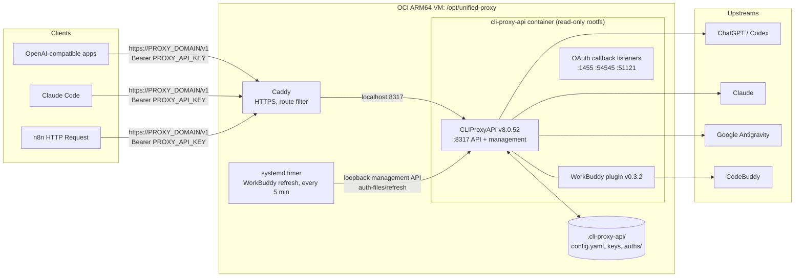
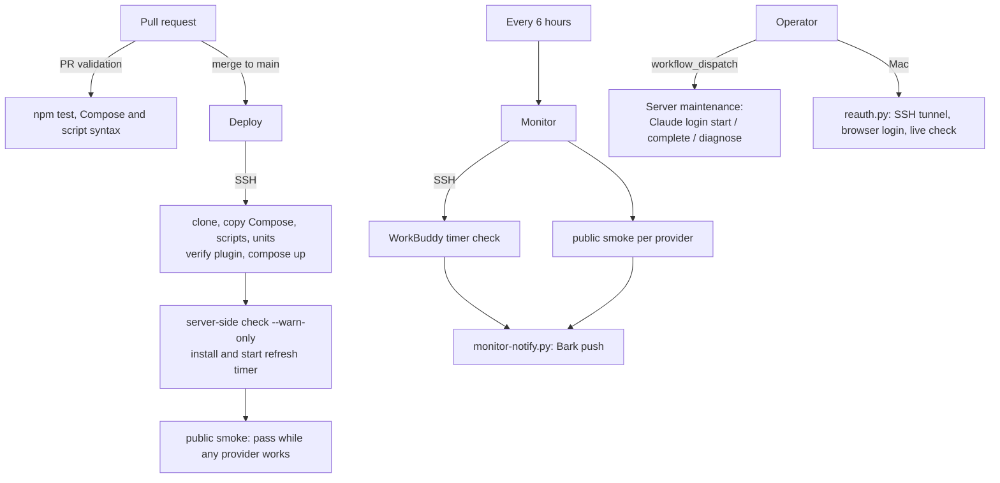

# Architecture

How the gateway, its credentials, and its automation fit together. For day-to-day tasks see the [README](../README.md); for installation and recovery see [operations and recovery](cli-subscriptions.md).

## Components

| Component | Role | Pinned by |
| --- | --- | --- |
| Caddy | Terminates TLS on the public domain, forwards client routes to `localhost:8317`, blocks `/v0/*`, `/v8/*`, `/management.html` and OAuth callback paths, maps `/health` and `/health/readiness` to the gateway's `/`. Its config lives on the server, not in this repository. | server config |
| CLIProxyAPI | Translates OpenAI Chat, Responses and Anthropic Messages requests to each provider, selects a credential, refreshes ChatGPT, Claude and Antigravity tokens itself, and serves the private management API. | image digest in [`compose.cli-proxy.yaml`](../compose.cli-proxy.yaml) |
| WorkBuddy plugin | Adds the CodeBuddy provider (GLM, Kimi, DeepSeek, Hunyuan, MiniMax models) and its OAuth login. | archive and binary SHA-256 in [`cli-proxy-install-plugin.py`](../scripts/cli-proxy-install-plugin.py) |
| WorkBuddy refresh timer | The plugin can refresh but does not tell the host when, so a timer asks CLIProxyAPI to refresh the WorkBuddy credential within ten minutes of expiry and verifies the new expiry was saved. | [`systemd/`](../systemd), [`cli-proxy-refresh-workbuddy.py`](../scripts/cli-proxy-refresh-workbuddy.py) |

The container runs as the `ubuntu` UID with a read-only root filesystem, no capabilities, `no-new-privileges`, a 512 MB memory limit and 128 PIDs. Every port is bound to `127.0.0.1`; only Caddy is public.

## Request path

1. A client calls `https://<PROXY_DOMAIN>/v1/...` with `Authorization: Bearer <PROXY_API_KEY>`.
2. Caddy forwards allowed routes to CLIProxyAPI on `localhost:8317`.
3. CLIProxyAPI checks the key against `upstream-key`, maps the model ID to its provider, and picks an active credential from `auths/` for that provider.
4. It calls the provider with the OAuth access token (CodeBuddy through the plugin) and translates the reply back to the client's format.

A model appears in `/v1/models` only while its provider has a usable credential, which is why the monitor reports an invalid account as `model absent`.

## Credentials and keys

| Secret | Where it lives | Who uses it |
| --- | --- | --- |
| Client key `PROXY_API_KEY` | server `upstream-key`, local `.env.secrets`, GitHub secret, clients | clients, smoke and monitor checks |
| Management key | server `management-key` only | refresh timer (on the server), `cli-proxy-oauth-login.py` (on the server), `reauth.py` (read over SSH into memory) |
| Provider OAuth tokens | server `auths/*.json` | CLIProxyAPI; never read by repository tools except the WorkBuddy expiry check |
| SSH key `OCI_SSH_KEY` | local key file, GitHub secret | deploy, monitor timer check, server maintenance, `reauth.py` |
| `BARK_KEY` | `.env.secrets`, GitHub secret | monitor alerts |

The management API is reachable only on the server's loopback, so every tool that uses it either runs on the server or tunnels in over SSH. Tools that send the management key disable HTTP proxies and reject redirects so the key cannot be forwarded elsewhere.

Tokens rotate without operator action: CLIProxyAPI refreshes ChatGPT, Claude and Antigravity; the timer drives WorkBuddy. A revoked or expired refresh token needs a new login, which writes a new file in `auths/`. CLIProxyAPI may write new credential files with looser modes than 600; the refresh timer only enforces private modes on WorkBuddy files so another provider's file cannot stop it.

## Automation

| Workflow or tool | Trigger | Fails when |
| --- | --- | --- |
| [PR validation](../.github/workflows/pr-validation.yml) | every PR to `main` | unit tests or syntax checks fail |
| [Deploy](../.github/workflows/deploy.yml) | push to `main`, except docs-only | gateway unreachable, every provider fails, or a deploy-owned step fails (marker, plugin hash, Compose, timer install) |
| [Monitor](../.github/workflows/monitor.yml) | every six hours, or manual | gateway down or every provider fails; partial failures only warn and push |
| [Server maintenance](../.github/workflows/server-maintenance.yml) | manual, `main` only | Claude login or its live verification fails |
| [`reauth.py`](../scripts/reauth.py) | operator's Mac | login fails, times out, or the live check fails |

Deploy and maintenance share the `unified-proxy-production` concurrency group, so they never run on the server at the same time.

### Failure semantics

The gateway is useful while any provider works, so every automated check treats providers independently ([`cli-proxy-public-smoke.py`](../scripts/cli-proxy-public-smoke.py) `--monitor`, the default through `smoke.sh`):

- Gateway-level checks (runtime identity, authenticated catalog, anonymous rejection, blocked management routes) failing marks every provider failed.
- A provider fails if any of its expected models is missing from the catalog or its live reply is empty or an error. The reason is recorded per provider.
- The run exits non-zero only when all providers fail. [`monitor-notify.py`](../scripts/monitor-notify.py) turns the result into a normal or time-sensitive Bark push.

## Repository layout

| Path | Purpose |
| --- | --- |
| `compose.cli-proxy.yaml` | The single service, pinned image, private ports, hardening |
| `scripts/cli-proxy-init.py` | First install only: creates keys and config without overwriting |
| `scripts/cli-proxy-install-plugin.py` | Downloads and hash-checks the WorkBuddy plugin |
| `scripts/cli-proxy-smoke.py` | Server-side check during deploy (plugin, catalog) |
| `scripts/cli-proxy-public-smoke.py`, `scripts/smoke.sh` | Public per-provider check used by deploy, monitor and `npm run smoke` |
| `scripts/monitor-notify.py` | Bark alerts from monitor results |
| `scripts/cli-proxy-refresh-workbuddy.py`, `scripts/cli-proxy-install-refresh.sh`, `systemd/` | WorkBuddy refresh timer |
| `scripts/reauth.py` | Local re-authentication and credential status for all providers |
| `scripts/cli-proxy-oauth-login.py` | Server-side Claude and Codex login used by the maintenance workflow |
| `scripts/build-reauth-shortcut.py` | Generates the iPhone shortcut that drives the maintenance workflow |
| `scripts/push-secrets.sh` | Sync `.env.secrets` to GitHub secrets |
| `scripts/cli-proxy-retire-legacy.py` | One-time retirement of the old Node/LiteLLM stack |
| `test/` | Unit tests, no network |
